# Gaffer

**Draft. Argue. Settle it.** A fast football draft game for you and your mates. Build an XI from legends and modern stars, steal your friend's target, set your tactics, and let a match engine settle the argument. Play your mate, play the CPU, or run a whole league or cup together. Free, no accounts, runs in the browser, built to deploy on Cloudflare.

| | |
|---|---|
| 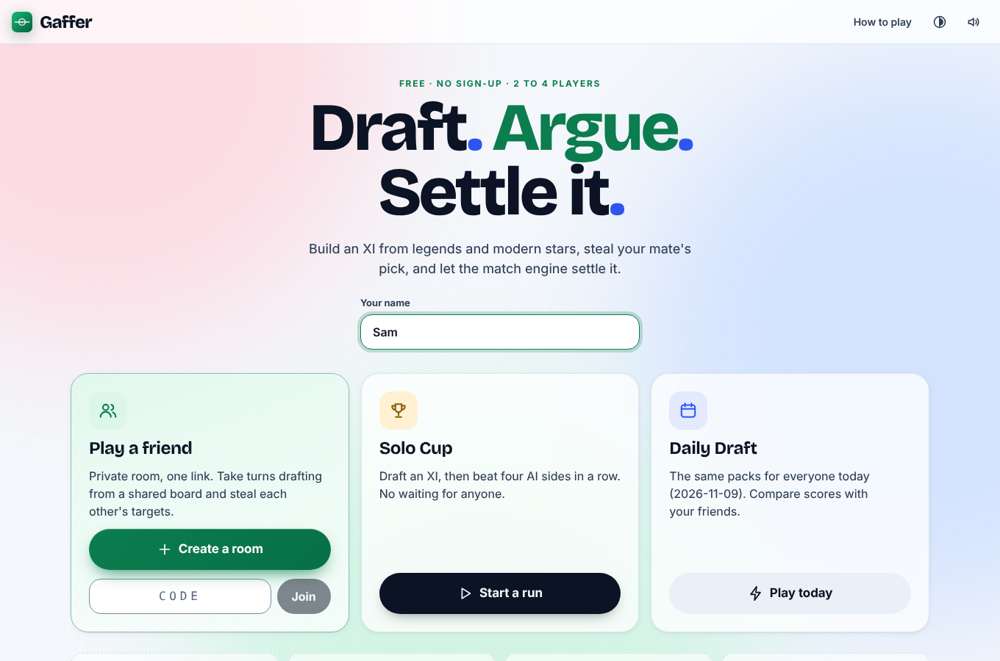 | 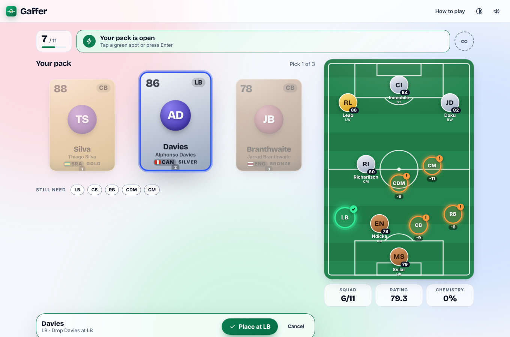 |
| 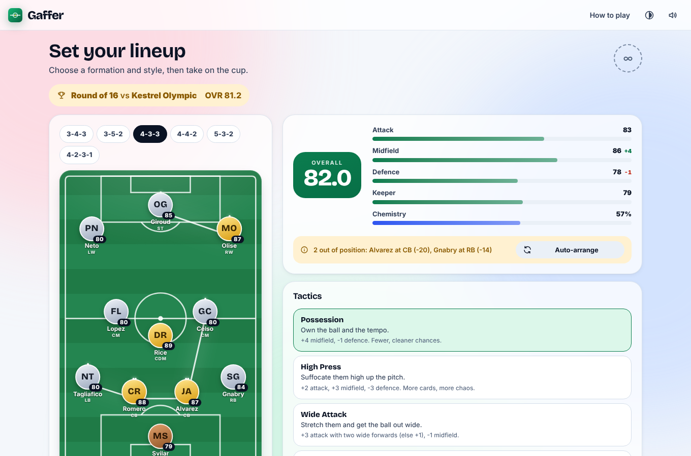 | 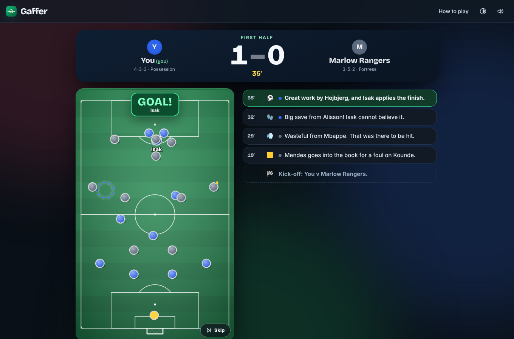 |

<p align="center">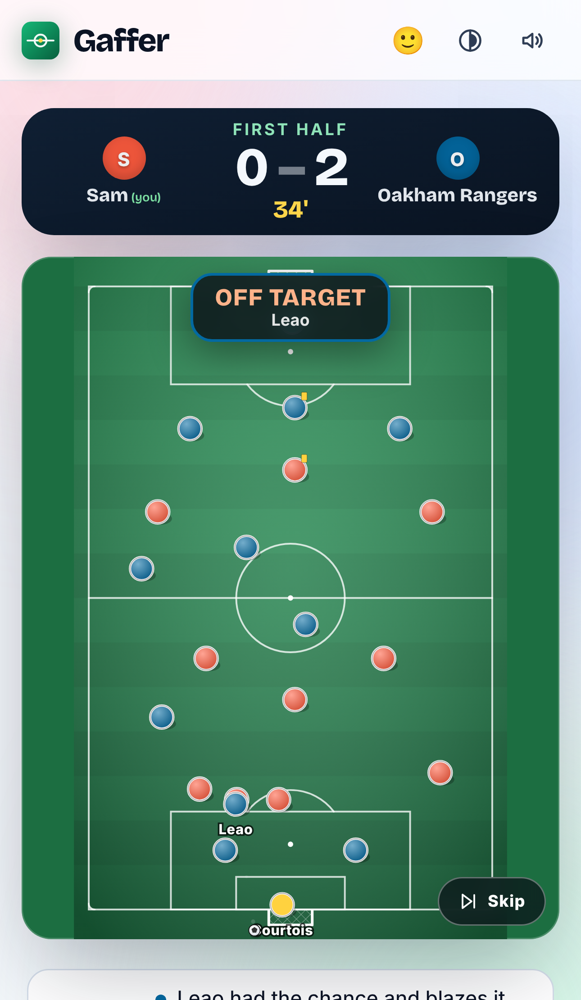 &nbsp; 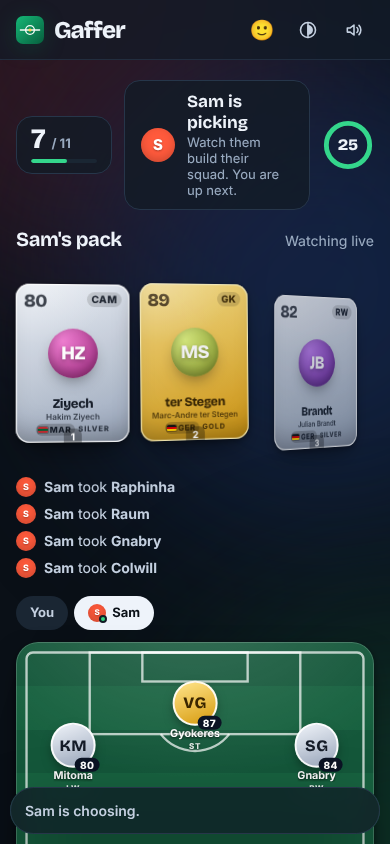 &nbsp; 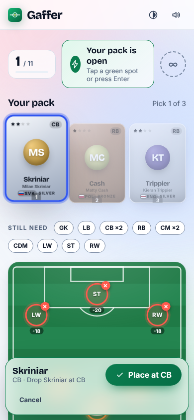</p>

<p align="center">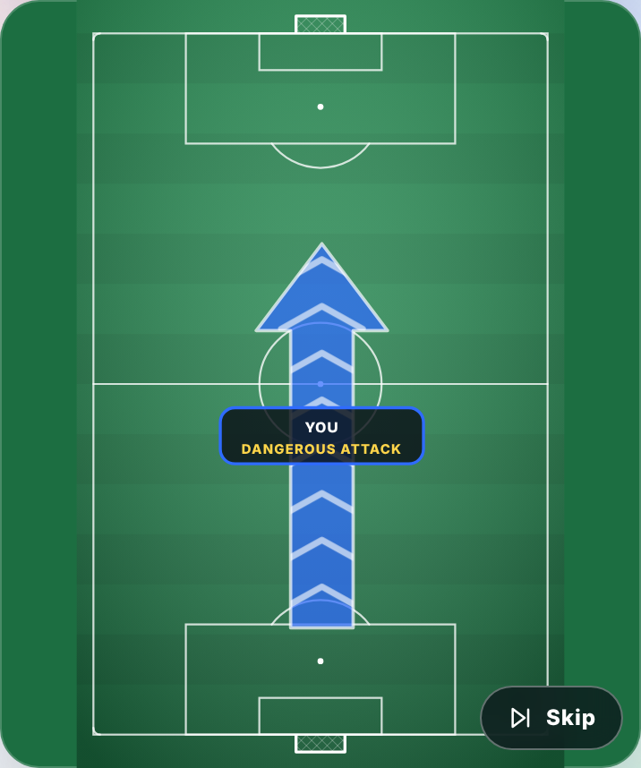</p>

<p align="center">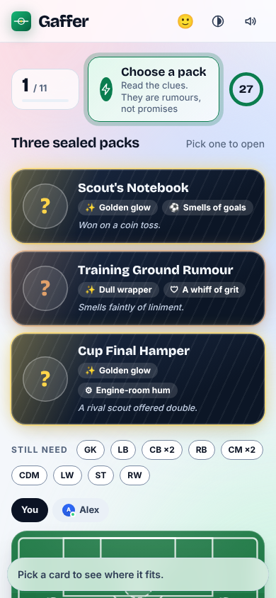 &nbsp; 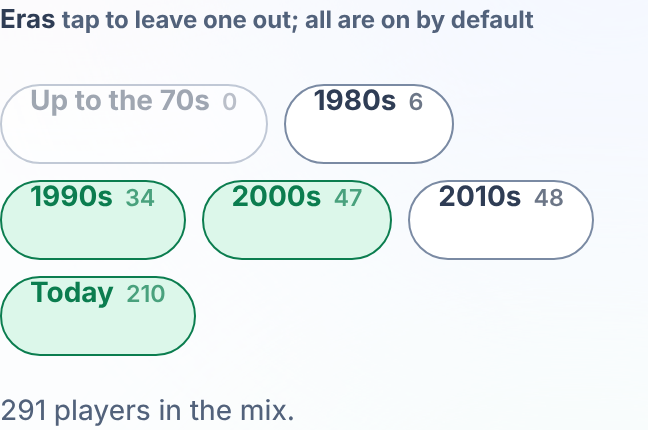</p>

<p align="center">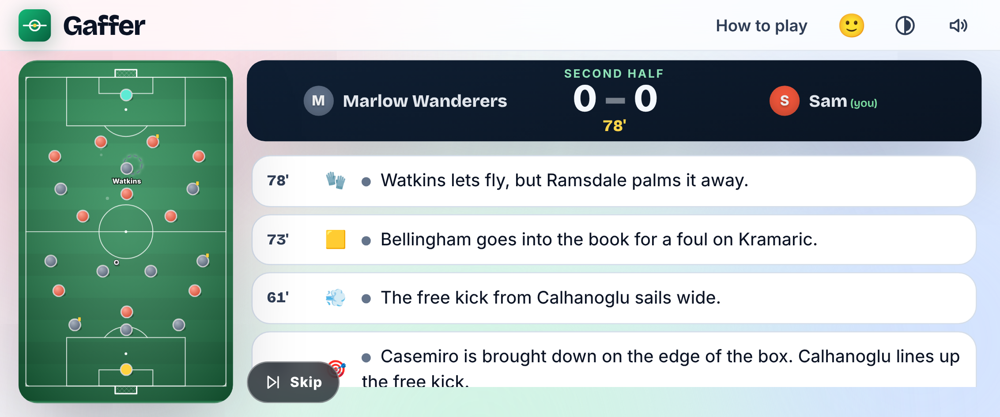</p>

## What you can do

- **Career mode (new).** Pick a real Balkan club (or invent one) and manage it season after season, alone or with up to three friends. Every club, yours and the computer's, **drafts 20 real players from all sixteen First League squads** in a snake order; then 30 matchdays with a **bench, injuries and bans**, a **mid-season transfer window** (three changes are free; more and your new players need time to settle and the whole team loses sharpness, never points), a season-end window, **promotion and relegation** between a First and a Second League, and players who age. Squads come from Wikipedia and Wikidata (see `data/README.md`); **the ratings are estimates and say how they were made**. Sign in with Google or play as a guest. Matchdays work together or apart: they play when every manager is ready, or at a deadline with your saved line-up, and you can watch your match any time afterwards.
- **Bosnian version.** EN | BS in the top bar. Every screen is translated: career mode, the home page, rooms and lobby, the draft and packs, the cup and daily, how to play, the pitch labels and the match commentary, headline and man-of-the-match text. The wording was written by AI and given one independent review pass; it has not been read by a native speaker, so expect a few awkward phrases and tell us which.
- **Play a friend, or the CPU, or both.** One button makes a room: a 4-letter code and a link. 1 to 4 people. Add CPU teams at three levels and one phone is enough.
- **Run a tournament.** Single match, **league** (everyone plays everyone, once or home and away), **groups then knockout**, or straight **knockout** with extra time and penalties. 2 to 16 teams. CPU teams draft after you from what is left.
- **Only watch your own games.** Two friends side by side each see their own match. Games between CPU teams are just a result: they appear in the table between matchdays and nobody sits through them.
- **Duel draft.** One shared board per round, snake order. Once a card is taken it is gone, so you can steal your mate's target.
- **Packs draft.** Each round you choose between **three sealed packs** before you see a single player, then pick one of the three inside. Every pack carries a name, a glow, a smell (goals, grit, engine room, gloves) and a rumour. They are hints, not promises: the glow is right a bit over half the time on purpose, so choosing feels tactical but is mostly luck. No flags or crests, the mystery is in the packaging.
- **Take turns draft.** One of you drafts a whole squad while the other watches the pack and the pitch fill up live, then you swap, then the CPU teams draft. Nobody drafts at the same time, and because each person has their own packs there is no stealing. Who goes first alternates every game.
- **Themed pools and eras.** Draft from Modern Stars, the Hall of Legends, Everyone, the **Premier League** (anyone who played there) or the **Balkans** (Bosnia, Croatia and Serbia, with some league players), and narrow it by era with a tap: up to the 70s, the 80s, 90s, 2000s, 2010s or today. A mix that is too thin for the number of teams is refused, with the reason on screen.
- **See the fit.** Every spot on the pitch shows how well a player suits it (natural, close, a stretch, out of position) as colour, icon and words, with the exact rating penalty. Same-nation neighbours link for chemistry.
- **Pick tactics.** Five styles, each with a stated trade-off. Your rival can't see your lineup or tactics until kick-off.
- **Watch the match as a story.** Quiet play is one big arrow across the pitch with the team's name on it: it points at the goal that team is attacking, its tip creeps toward that goal as the attack gets dangerous, and a clear-cut chance reads BIG CHANCE and turns their half red-hot. The danger is the match engine's own chance of scoring, so the arrow never overstates. Dots and the ball appear only for real highlights (goals, penalties, red cards and real chances), move at a believable pace (nobody runs faster than a sprinter, nothing teleports, measured by a test) and fade away again. Yellow cards, speculative shots and routine set pieces are a label on the arrow. A match takes about a minute and a half, and extra time and penalties happen when the stage needs a winner. Skip is still there if you want it.
- **Real-world rates.** Cards, penalties and free kicks follow Premier League and top-five-league averages, and individual players are booked, fouled and take penalties in line with their reputation (see the note on the players).
- **Keep score.** A series score survives rematches; the first pick rotates so it stays fair.
- **Solo Cup** (four knockout rounds against AI, instant) and **Daily Draft** (identical packs for everyone today).
- **Never gets stuck.** Lock your phone or switch apps and the game waits for you: on your own against CPU teams everything freezes, and a match resumes from the minute you left. With a friend still playing, a dropped player gets 45 seconds before the game carries on without them. Close the tab and the same link on the same device puts you straight back.

## Run it

```bash
npm install
npm run dev          # Vite on :5173 + Cloudflare's local runtime on :8787. Open http://localhost:5173
npm run dev:node     # same, but with the plain Node host instead of Cloudflare's runtime
```

## Put it online (Cloudflare)

```bash
npx wrangler login
npm run deploy
```

That is the whole deploy: it builds the client and publishes one Worker that serves the site and runs a Durable Object per room. Step by step, custom domain, and GitHub auto-deploy are in **[DEPLOY.md](DEPLOY.md)**.

**Why Cloudflare and not Vercel?** Real-time rooms need long-lived WebSockets. Vercel's functions can't hold them, so you would need a paid relay service on top. On Cloudflare it is one deploy, one object per room, and idle rooms cost nothing.

## Test it

```bash
npm test                   # 296 unit, simulation, tournament, room-machine, chaos, socket, career, sign-in, data and translation tests
npm run test:e2e           # real browsers: two-player games, two phones in a league, one phone at five sizes,
                           # reconnects, accessibility audit, and a hard kill-and-restart of the runtime
npm run check:persistence  # just the kill-and-restart check (boots its own copy of the runtime)
npm run check:career       # career API on the real runtime: sign-in, a league, SIGKILL and restart
npm run test:all           # typecheck + unit + build + e2e + brand sweep
```

What is covered, and what is not, is written down in [replica/test-plan.md](replica/test-plan.md) and [replica/devils-advocate.md](replica/devils-advocate.md). The short version: tested in Chromium only. iPhone and Android are *emulated* (screen size, touch, safe areas), not run on real devices or in WebKit, so try it on your two phones before trusting it.

## How it is built

```
src/shared/   the whole game as pure TypeScript: players, formations, fit, chemistry, draft dealing,
              match simulation, tournaments (competition.ts), CPU teams (bots.ts), player discipline and
              set-piece traits (playerstats.ts) and RoomEngine (the multiplayer state machine, clock injected)
src/server/   RoomHost (validation, rate limit, reconnect, broadcast) and two thin shells around it:
              a Cloudflare Durable Object (worker.ts, room-do.ts) and a Node host (node-dev.ts)
src/client/   React screens, design tokens, resilient socket layer, and the live pitch (lib/scene.ts is a pure
              function from a finished match and a clock to dot and ball positions, so it is unit-tested)
tests/ e2e/   vitest and Playwright
replica/      the reverse-engineering, parity score, bug log and the devil's advocate report
data/         sourced squads of 16 Balkan clubs (Wikipedia + Wikidata, every row pinned to a source) for the
scripts/data/ planned season mode; the fetch / parse / merge pipeline. Not used by the game yet. See data/README.md
```

Key decisions: the server owns every rule; the match and every board come from a seed; a tournament is simulated matchday by matchday and only matches a human plays keep their full story; state is persisted so a redeploy never loses a draft; the player pool ships with the build so there is no database to go down.

## Make it yours

- **Rename it:** `src/shared/brand.ts`, then `index.html` and `public/manifest.webmanifest`. `npm run check:brand` checks nothing of the study target survives.
- **Change players or ratings:** `src/shared/players.ts` is one readable file. Tests check IDs, nations and depth.
- **Tune the match engine:** `src/shared/sim.ts`. The numbers it should hit are pinned in `tests/sim.test.ts`.
- **Colours:** `src/client/styles/tokens.css`; contrast was verified with `replica/design/*.json`.

## A note on the players

**Premier League and eras are my recollection too.** Which players ever played in the Premier League, and which decade each retired player peaked in, are judgement calls from memory (`src/shared/pools.ts`). A test checks every name matches a real player, but not that I remembered correctly. The **Balkan** pool adds 72 players from Bosnia, Croatia and Serbia (current internationals and some league players) with my own rough ratings. I could not recall the Bosnian league reliably, so it is not there: send me names and ratings and I will add them.

**Real squads are a separate, sourced dataset.** `data/` holds the current first-team squads of 16 Balkan clubs, read from Wikipedia club articles (revision pinned per club) with birth dates from Wikidata. Nothing in it is written from memory, and gaps stay gaps: about two thirds of players have a birth date, positions are only goalkeeper / defender / midfielder / forward, and there are **no ability ratings** (no free, sourced feed exists), so any rating in a future season mode will be a labelled estimate. Squad facts are from Wikipedia (CC BY-SA 4.0, credit: Wikipedia contributors) and Wikidata (CC0). The game does not use this data yet.

The cards, fouls and penalties in a match are driven by league-wide averages (about 4 yellows and 0.15 reds a match, a penalty roughly every 3 or 4 games converting at about 78%). The per-player traits (who gets booked, who takes and scores penalties, who scores free kicks) are **my approximate recollections of reputations, not scraped statistics**, and the free-kick conversion rate is an estimate. They give the right flavour (a notorious tackler is booked more than a clean player) without pretending to be data. Edit them in `src/shared/playerstats.ts`.

Gaffer is an independent fan game. Player names identify the footballers; there are no photos, likenesses, badges or kits. The ratings are this project's own rough opinions of players at their peak, not official data. That is fine between friends. If you ever want to promote it or put ads on it, get proper advice about using real names first.

## How it was made

A clean-room rebuild: the public pages and the live game of a popular browser football draft game were studied as a player would use them, with the Replica method (recon, architecture, design, build, test, diff, rebrand). No code, assets, copy, or private endpoints were taken. See `replica/` for the findings.
