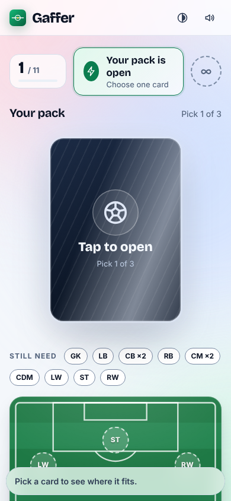

# Gaffer

**Draft. Argue. Settle it.** A fast football draft game for you and your mates. Build an XI from legends and modern stars, steal your friend's target, set your tactics, and let a match engine settle the argument. Free, no accounts, runs in the browser, built to deploy on Cloudflare.

| | |
|---|---|
|  |  |
|  |  |

<p align="center"> &nbsp; </p>

## What you can do

- **Play a friend.** One button makes a room: a 4-letter code and a link. 2 to 4 players.
- **Duel draft.** One shared board per round, snake order. Once a card is taken it is gone, so you can steal your mate's target.
- **Packs draft.** Everyone opens their own sealed pack at the same time. The glow hints at the best card inside.
- **See the fit.** Every spot on the pitch shows how well a player suits it (natural, close, a stretch, out of position) as colour, icon and words, with the exact rating penalty. Same-nation neighbours link for chemistry.
- **Pick tactics.** Five styles, each with a stated trade-off. Your rival can't see your lineup or tactics until kick-off.
- **Watch the match.** A seeded, minute-by-minute story with named scorers, cards, saves, extra time and penalty shootouts. Both players see the same match at the same time. Skip any time.
- **Keep score.** A series score survives rematches; the first pick rotates so it stays fair.
- **Solo Cup** (four knockout rounds against AI, instant) and **Daily Draft** (identical packs for everyone today).
- **Never gets stuck.** Lose your connection and your seat waits. Someone goes AFK and the draft auto-picks after a few seconds. Close the tab and the same link on the same device puts you straight back.

## Run it

```bash
npm install
npm run dev          # Vite on :5173 + Cloudflare's local runtime on :8787. Open http://localhost:5173
npm run dev:node     # same, but with the plain Node host instead of Cloudflare's runtime
```

## Put it online (Cloudflare)

```bash
npx wrangler login
npm run deploy
```

That is the whole deploy: it builds the client and publishes one Worker that serves the site and runs a Durable Object per room. Step by step, custom domain, and GitHub auto-deploy are in **[DEPLOY.md](DEPLOY.md)**.

**Why Cloudflare and not Vercel?** Real-time rooms need long-lived WebSockets. Vercel's functions can't hold them, so you would need a paid relay service on top. On Cloudflare it is one deploy, one object per room, and idle rooms cost nothing.

## Test it

```bash
npm test             # 44 unit, simulation, room-machine, chaos and socket tests
npm run test:e2e     # real browsers: two-player games, reconnects, solo cup, accessibility audit
npm run test:all     # typecheck + unit + build + e2e + brand sweep
```

What is covered, and what is not, is written down in [replica/test-plan.md](replica/test-plan.md) and [replica/devils-advocate.md](replica/devils-advocate.md). The short version: tested in Chromium only, not on a real phone.

## How it is built

```
src/shared/   the whole game as pure TypeScript: players, formations, fit, chemistry, draft dealing,
              match simulation, and RoomEngine (the multiplayer state machine, clock injected)
src/server/   RoomHost (validation, rate limit, reconnect, broadcast) and two thin shells around it:
              a Cloudflare Durable Object (worker.ts, room-do.ts) and a Node host (node-dev.ts)
src/client/   React screens, design tokens, resilient socket layer
tests/ e2e/   vitest and Playwright
replica/      the reverse-engineering, parity score, bug log and the devil's advocate report
```

Key decisions: the server owns every rule; the match and every board come from a seed; state is persisted so a redeploy never loses a draft; the player pool ships with the build so there is no database to go down.

## Make it yours

- **Rename it:** `src/shared/brand.ts`, then `index.html` and `public/manifest.webmanifest`. `npm run check:brand` checks nothing of the study target survives.
- **Change players or ratings:** `src/shared/players.ts` is one readable file. Tests check IDs, nations and depth.
- **Tune the match engine:** `src/shared/sim.ts`. The numbers it should hit are pinned in `tests/sim.test.ts`.
- **Colours:** `src/client/styles/tokens.css`; contrast was verified with `replica/design/*.json`.

## A note on the players

Gaffer is an independent fan game. Player names identify the footballers; there are no photos, likenesses, badges or kits. The ratings are this project's own rough opinions of players at their peak, not official data. That is fine between friends. If you ever want to promote it or put ads on it, get proper advice about using real names first.

## How it was made

A clean-room rebuild: the public pages and the live game of a popular browser football draft game were studied as a player would use them, with the Replica method (recon, architecture, design, build, test, diff, rebrand). No code, assets, copy, or private endpoints were taken. See `replica/` for the findings.
